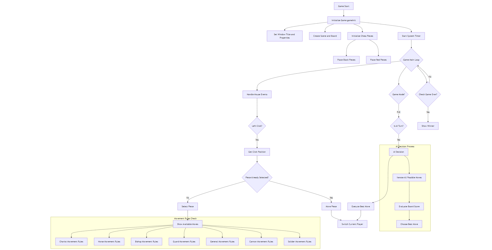

# Chinese Chess

# What
Chinese Chess, or Xiangqi (象棋), is a traditional strategic board game for two players,
originating from China. The game is played on a board with 9 vertical and 10 horizontal lines. 
Each player commands an army of 16 pieces: one General, two Guard, two Bishop, two Horses, 
two Chariots, two Cannons, and five Soldiers.
The primary objective is to checkmate the opponent’s General. 
Each piece has unique movement rules: the General moves one space within a designated palace; 
Guards move diagonally within the palace; Bishops move two spaces diagonally but cannot cross the river; Horses move in an "L" shape; 
Chariots move any number of spaces horizontally or vertically; Cannons capture by jumping over one piece; and Soldiers move forward, 
with additional sideways movement after crossing the river.Players take turns moving one piece, 
with the game ending when a player checkmates the opponent's General. Special rules, such as preventing repeated moves, 
may lead to a draw. Xiangqi combines deep strategy and tactical skill, 
making it a popular and culturally significant game in Chinese society.

# Name table
Left is black pieces, right is red pieces

Chariots 車/俥

Knights or horses 馬/傌

Bishop 象/相

Guards 士/仕

Generals 将/帥

Cannons 砲/炮

Soldiers 卒/兵

River 楚河漢界

# WHY
Class Definitions
Inheritance and Polymorphism
Signals and Slots
Multithreading
Graphics Rendering
Minimax Algorithm
Data Structures
Mouse Events
Keyboard Events
Lambda Expressions
Constructors and Destructors

# Install display and its related dependencies
```bash
sudo apt install -y \
    xfce4 \
    xfce4-goodies

sudo apt install -y \
        libxcb-xinerama0 \
        libxcb-xinerama0-dev  \
        libxcb-cursor0 \
        libxcb-cursor-dev \
        libxkbcommon-x11-0 \
        libxcb-icccm4 \
        libxcb-icccm4-dev \
        libxcb-keysyms1 \
        libxcb-keysyms1-dev \
        libxcb-randr0 \
        libxcb-randr0-dev \
        libxcb-render-util0 \
        libxcb-render-util0-dev \
        libxcb-shape0 \
        libxcb-shape0-dev \
        libxcb-sync-dev \
        libxcb-xfixes0 \
        libxcb-xfixes0-dev
```
# Install cmake

```
sudo apt install cmake
```

# Install Qt6

Because the Qt that comes with Ubuntu 22.04 lacks some qt libraries, 
we use the qt installer to install it

qt-online-installer-linux-x64-4.8.1 This is our qt installer

After running, select the default installation

After the installation is complete, we need to set the path to search for qt in cmake

export CMAKE_PREFIX_PATH=/opt/Qt/...

# Install Chinese fonts

```bash
sudo apt install -y \
    fonts-noto-cjk 
```

# Compile

Create a build directory in the source code directory for compilation

```
mkdir build
```

Enter the build directory

```
cd build
```

Compile using cmake

```
cmake ..
make
```

# RUN

```
./chinese_chess
```

# Architecture diagram


